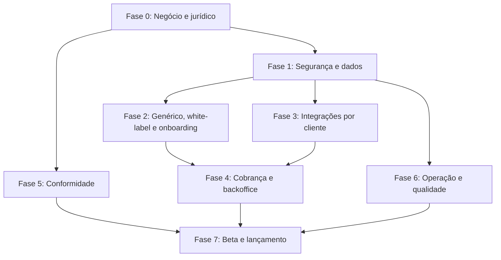

 

# Plano de Comercialização: da NutrIsa (Dra. Isabela) ao SaaS para qualquer nutricionista

> Objetivo: transformar a plataforma hoje feita sob medida para a Dra. Isabela em um produto SaaS multi-clínica, seguro, legal e cobrável.
> Este documento é o guia mestre. O [roadmap.md](roadmap.md) e o [tasks.md](tasks.md) tratam da evolução clínica; este trata da **transição para produto**.
> Legenda de prioridade: 🔴 bloqueador de lançamento · 🟠 necessário no lançamento · 🟡 até 90 dias após o lançamento · 🟢 evolução.
> Legenda de esforço (estimativa de 1 desenvolvedor): **P** ≤ 2 dias · **M** 3–7 dias · **G** 1–3 semanas · **GG** > 3 semanas.

> [!IMPORTANT]
> Itens marcados "VERIFICAR" são pontos que não foram confirmados no código. Faça a auditoria antes de assumir que estão corretos. Itens jurídicos e fiscais devem ser validados por advogado e contador.

---

## 0. Diagnóstico do estado atual

### 0.1 O que já existe e ajuda

| Ativo                                        | Onde                                                                                                | Valor para o produto                     |
| -------------------------------------------- | --------------------------------------------------------------------------------------------------- | ---------------------------------------- |
| Organização (clínica) + membros + convites   | `AuthContext.jsx`, `teamService.js`, migrations `secure_team_permissions` e `protect_master_access` | Base de multi-tenancy já iniciada        |
| Permissões por módulo (13 módulos)           | `permissions.js`, [team-permissions.md](reference/team-permissions.md)                              | Pronto para planos "Equipe"              |
| RLS com isolamento por organização           | migrations Supabase                                                                                 | Base de segurança (precisa de auditoria) |
| IA com fallback (Gemini → OpenAI → DeepSeek) | `server/ai`, [ai-providers-fallback.md](reference/ai-providers-fallback.md)                         | Resiliência                              |
| Catálogo unificado de alimentos (TACO 4)     | migrations `product_catalog`, `populate_full_taco4_catalog`                                         | Diferencial de dietas                    |
| Modelos de documento por clínica             | `document_templates`                                                                                | Base de personalização                   |
| Testes unitários                             | `tests/unit`                                                                                        | Base de qualidade                        |

### 0.2 O que impede a venda hoje (achados do código)

| #   | Achado                                                         | Evidência                                                                                             | Risco                                                                               |
| --- | -------------------------------------------------------------- | ----------------------------------------------------------------------------------------------------- | ----------------------------------------------------------------------------------- |
| A1  | Cadastro fechado                                               | `signInWithOtp({ shouldCreateUser: false })` em `AuthContext.jsx`                                     | Cliente novo não consegue entrar                                                    |
| A2  | Clínica criada com nome fixo                                   | `bootstrap_organization({ p_name: 'NutrIsa' })`                                                       | Toda clínica nova nasce como "NutrIsa"                                              |
| A3  | Perfil da Dra. Isabela como padrão                             | `configuracoes/defaultProfile.js` (nome, CRN, telefone, e-mail, endereço, Instagram reais)            | Vazamento de dados pessoais; cliente vê dados alheios                               |
| A4  | Marca e nome da Dra. espalhados                                | ~65 arquivos (layout, relatórios, contratos, marketing, dietas, assinatura pública)                   | Sem white-label                                                                     |
| A5  | Persistência em `localStorage`                                 | `storageKeys.js`: perfil, tarefas, templates, rascunhos, token Google, CRM, histórico de contratos    | Dado preso ao navegador; perda e inconsistência entre dispositivos                  |
| A6  | Token de IA único compartilhado                                | `AI_ACCESS_TOKEN` digitado no painel e guardado no navegador                                          | Sem controle por cliente, sem cota, sem custo rastreável                            |
| A7  | Token do Google no navegador                                   | `nutriisa_google_token`                                                                               | Expira, não renova, é inseguro e exige verificação de app no Google                 |
| A8  | WhatsApp via n8n + Evolution API, instância `IsaNutri`         | [atendimento-metrics.md](reference/atendimento-metrics.md)                                            | API não oficial (risco de banimento), instância única, workflow único               |
| A9  | URL de produção como fallback do webhook                       | `VITE_N8N_WHATSAPP_SEND_URL` ausente → URL de produção                                                | Risco de um ambiente de teste ou outro cliente enviar mensagens pela instância dela |
| A10 | Regras de negócio específicas da clínica                       | `evaluateSecretaryGoals`, bonificação, grupos `isabela`/`secretaria`, SLA 08–18h seg–sex, teto de 25% | Funcionalidade que só faz sentido para um consultório                               |
| A11 | Taxonomia de agenda do WebDiet/cores fixas                     | `calendarMapper.js`, [calendar-categories.md](reference/calendar-categories.md)                       | Outros profissionais usam outras convenções                                         |
| A12 | Dados de terceiros sem licença avaliada                        | TBCA via Parse ("API independente, não oficial"), USDA FDC, TACO                                      | Risco jurídico e de indisponibilidade                                               |
| A13 | Código de convite com marca                                    | exemplos `NUTRISA-2026`, `ISABELA-2026`                                                               | Cosmético, mas revela dependência                                                   |
| A14 | IA paga na conta do dono                                       | chaves Gemini/OpenAI/DeepSeek únicas                                                                  | Custo ilimitado sem receita correspondente                                          |
| A15 | Agenda somente leitura                                         | "não há gravação no Google"                                                                           | Concorrentes escrevem e marcam consultas                                            |
| A16 | Papéis rotulados "Dra."                                        | `owner` = "Dra. / Proprietária"                                                                       | Texto não genérico (nutricionista homem, clínica)                                   |
| A17 | Sem camada de cobrança, planos e limites                       | ausente                                                                                               | Impossível cobrar                                                                   |
| A18 | Sem termos, política de privacidade, consentimento por clínica | ausente (VERIFICAR `patients-database.md`)                                                            | Risco LGPD                                                                          |

---

## FASE 0: Decisões de negócio e jurídico (antes de codar) 🔴

Nada técnico deve começar sem estas respostas. Cada decisão muda o escopo das fases seguintes.

### 0.1 Decisões de produto e mercado

- [ ] **Cliente-alvo**: nutricionista autônomo, clínica pequena (2–5 pessoas) ou clínicas maiores. Recomendação: começar por **autônomo e clínica pequena**.
- [ ] **Posicionamento**: o que a NutrIsa faz que Dietbox, WebDiet, Nutrium e similares não fazem? Candidatos: IA integrada à conversa de WhatsApp, CRM de retorno (radar), estúdio de marketing, contratos e assinatura. Defina em uma frase.
- [ ] **Pesquisa com 10 a 15 nutricionistas**: dor principal, quanto pagam hoje, o que trocariam.
- [ ] **Modelo de preço** (ver §10): mensal/anual, por profissional, por paciente ativo, e créditos de IA.
- [ ] **O que fica fora do produto genérico**: bonificação da secretária, metas de SLA (ver A10). Decidir se viram módulo opcional ("Gestão de recepção") ou ficam como configuração.
- [ ] **Metas de 12 meses**: nº de clientes pagantes, MRR, churn máximo.

### 0.2 Decisões jurídicas e societárias

- [ ] **Titularidade do software**: acordo escrito com a Dra. Isabela sobre propriedade intelectual, uso do código e dos dados dela, e eventual sociedade ou licença. Sem isso o produto não pode ser vendido com segurança.
- [ ] **Pessoa jurídica**: abrir CNPJ (MEI não serve para SaaS em escala; avaliar ME/Simples Nacional, CNAE de desenvolvimento e licenciamento de software).
- [ ] **Nome e marca**: "NutrIsa" remete à Dra. Isabela. Escolher nome próprio, consultar o INPI, registrar a marca e o domínio (.com.br e .com).
- [ ] **Papéis LGPD** (ver §7): a NutrIsa é **operadora** dos dados dos pacientes; o nutricionista é **controlador**. Definir e documentar.
- [ ] **Advogado especializado** em SaaS e saúde digital para revisar termos, privacidade e DPA.
- [ ] **Responsabilidade clínica**: o software é ferramenta de apoio; a conduta é do profissional (reforçar nos termos e na interface).

---

## FASE 1: Segurança, isolamento e fundação de dados 🔴

Objetivo: garantir que nenhum cliente enxergue dados de outro e que os dados vivam no servidor, por organização.

### 1.1 Auditoria do multi-tenancy existente (G)

- [ ] Inventariar **todas** as tabelas do schema e confirmar que cada uma tem `organization_id` (ou relação direta com tabela que tenha) e **RLS habilitada**.
- [ ] Listar todas as políticas. Para cada tabela: `SELECT`, `INSERT`, `UPDATE`, `DELETE` cobertos, com `USING` e `WITH CHECK`.
- [ ] Revisar todas as funções `SECURITY DEFINER`: `search_path` fixo, validação interna de organização, sem SQL dinâmico.
- [ ] Revisar `bootstrap_organization`, convites e o `protect_master_access`: um usuário não pode se promover a owner nem ingressar em clínica alheia por adivinhação de código.
- [ ] Revisar `storage.buckets` e políticas de Storage (fotos de pacientes, exames, avatares): acesso apenas por organização, URLs assinadas e de curta duração.
- [ ] Revisar realtime (`log_conversas`): canais filtrados por organização.
- [ ] Revisar views e RPCs usados no radar CRM e no sweep (`sweep_sync_patient_data`, `sync_patient_avatar_from_whatsapp`).
- [ ] Rodar `get_advisors` (Supabase) de segurança e performance e corrigir tudo o que for crítico.

### 1.2 Testes automatizados de isolamento (M)

- [ ] Criar suíte que cria **duas organizações e dois usuários** e verifica que A nunca lê, grava, atualiza ou apaga dados de B, tabela por tabela.
- [ ] Incluir o teste no CI e bloquear o merge se falhar.
- [ ] Testar também papéis: secretária não acessa módulos não permitidos **no banco** (não só na interface).

### 1.3 APIs de servidor (`api/ai.js`, `api/products.js`, `server/*`) (M)

- [ ] Exigir JWT do Supabase em toda chamada; resolver a organização no servidor.
- [ ] Remover o `AI_ACCESS_TOKEN` compartilhado (A6): substituir por autenticação por usuário.
- [ ] Rate limit por organização e por IP.
- [ ] Validação de payload (tamanho, tipo MIME, páginas de PDF), limites de upload.
- [ ] Nunca registrar conteúdo clínico nos logs do servidor.
- [ ] Revisar CORS e cabeçalhos de segurança (CSP, HSTS, X-Frame-Options, Referrer-Policy) em `vercel.json`.

### 1.4 Migrar `localStorage` para o banco (G)

Cada item abaixo vira tabela ou coluna com `organization_id` (e `user_id` quando for preferência pessoal):

| Chave atual                                 | Destino                                                       | Observação                   |
| ------------------------------------------- | ------------------------------------------------------------- | ---------------------------- |
| `nutrisa_nutritionist`                      | `organization_profile` + `professional_profiles`              | Base do white-label (Fase 2) |
| `nutrisa_tasks`                             | tabela `tasks`                                                | Compartilhada pela equipe    |
| `nutrisa_anamnese_templates`/`draft`        | `document_templates` (já existe) + rascunhos por usuário      |                              |
| `nutrisa_contracts_config`/`plan_history`   | `organization_settings`                                       |                              |
| `nutrisa_selected_model`, `live_notifs`     | `user_preferences`                                            |                              |
| `nutriisa_google_token`, `google_meet_link` | Fase 3 (OAuth no servidor)                                    |                              |
| `nutrisa_ai_access`                         | removido                                                      | A6                           |
| CRM insights (`crmInsightsStorage`)         | tabela já criada em `crm_commercial_insights` (VERIFICAR uso) |                              |
| Dietas (`dietStorageService`)               | VERIFICAR se já usa Supabase por completo                     |                              |

- [ ] **Migração dos dados da Dra. Isabela** do `localStorage` para o banco, de forma automática e reversível (padrão já usado nos modelos de contrato).
- [ ] Tratar conflito offline x online e limpar chaves após a migração confirmada.

### 1.5 Ambientes, segredos e infraestrutura (M)

- [ ] Três ambientes: **local**, **staging** e **produção**, com projetos Supabase e Vercel separados.
- [ ] Segredos apenas em variáveis de ambiente do provedor; **rotacionar** todas as chaves hoje existentes (o `.env` local contém segredos; confirmar que nunca foram versionados e revisar o histórico do Git).
- [ ] Remover o fallback para URL de produção do webhook (A9): sem variável, o recurso fica desabilitado.
- [ ] Branch protection, revisão obrigatória e deploy automático para staging.
- [ ] CI: lint, testes, build, teste de isolamento e `npm audit`.

### 1.6 Backup, recuperação e retenção (M)

- [ ] Backups automáticos do Supabase com PITR (exige plano pago) e **teste periódico de restauração**.
- [ ] Definir RPO e RTO (ex.: perda máxima 15 min; recuperação em até 4 h).
- [ ] Política de retenção de dados por tipo (prontuário: regras do CFN/CRN; ver §7).

### 1.7 Pentest e revisão externa (G)

- [ ] Teste de invasão (interno com checklist OWASP ASVS ou contratado) antes do beta aberto. Prioridade: IDOR, RLS, upload de arquivos, injeção de prompt.

**Critério de saída da Fase 1:** teste de isolamento verde, nenhum segredo no navegador, nenhum dado de negócio em `localStorage`, advisors do Supabase sem críticos.

---

## FASE 2: Produto genérico, white-label e onboarding 🟠

### 2.1 Remover o que é da Dra. Isabela (M a G)

- [ ] Apagar `DEFAULT_NUTRITIONIST` e usar perfil vazio com preenchimento guiado (A3).
- [ ] Trocar `p_name: 'NutrIsa'` pelo nome informado no cadastro (A2).
- [ ] Substituir a marca "NutrIsa" nas telas por **nome do produto** (constante única) e, nos documentos do paciente (laudos, dietas, contratos, posts), pela **marca da clínica** (A4).
- [ ] Varredura de textos fixos: "Dra. Isabela", "Isabela", "Campinas", CRN, telefone, e-mail, Instagram, `isabelamunoznutri@hotmail.com`, instância `IsaNutri`, URLs de produção. Criar teste que **falha** se esses termos aparecerem no código-fonte.
- [ ] Renomear papéis para termos neutros: "Titular/Proprietário(a)", "Recepção", "Administrativo" (A16). Ajustar [team-permissions.md](reference/team-permissions.md).
- [ ] Gênero neutro ou configurável ("Dra./Dr./Nutri") em mensagens, contratos e prompts de IA.
- [ ] Prompts de IA: remover nome e estilo pessoais; incluir **tom de voz configurável** por clínica.

### 2.2 White-label de documentos (M)

- [ ] Cadastro de identidade visual: logo, cores primária e secundária, fonte (lista curta), rodapé, redes sociais.
- [ ] Aplicar nos PDFs: laudo de avaliação, dieta, orientações, contratos, relatórios, posts do estúdio (3 paletas fixas hoje → paleta derivada da marca).
- [ ] Assinatura profissional: nome, CRN-região/número com validação de formato, foto da assinatura.
- [ ] Pré-visualização antes de salvar.

### 2.3 Cadastro (signup) e onboarding (G)

- [ ] Tela de **criar conta** (e-mail+senha e Google), com confirmação de e-mail, recuperação de senha e política de senha (A1).
- [ ] Remover `shouldCreateUser: false` do cadastro público; manter regra restritiva só para convites de equipe.
- [ ] **Wizard de primeiro acesso**: (1) tipo de conta (autônomo/clínica), (2) perfil e CRN, (3) marca, (4) horários e tipos de consulta, (5) conectar agenda, (6) conectar WhatsApp (opcional), (7) importar pacientes (opcional), (8) tour guiado.
- [ ] **Dados de demonstração** isolados e removíveis com um clique (hoje há `demoDietData.js`; padronizar).
- [ ] Checklist de ativação persistente no painel ("faltam 3 passos").
- [ ] Convite de equipe por **e-mail** (não só código de clínica), com expiração e revogação (A13).
- [ ] Verificação de **CRN** (autodeclarado + campo para documento; consulta ao CFN apenas se houver fonte oficial).
- [ ] Um usuário em **várias organizações** (nutricionista que atende em duas clínicas): seletor de organização. (VERIFICAR modelo atual de `organization_members`.)

### 2.4 Configurabilidade do que hoje é fixo (G)

- [ ] **Agenda** (A11): tela para mapear cores/palavras-chave do Google Calendar para tipos de consulta e status; oferecer 2–3 presets (incluindo o da Dra. Isabela como "preset exemplo").
- [ ] **Horário comercial e SLA** (A10): configuráveis por clínica, em vez de seg–sex 08–18h fixo.
- [ ] **Metas e bonificação**: transformar em módulo opcional "Metas da recepção" com metas editáveis; desligado por padrão.
- [ ] **Tipos de consulta, durações e valores** por clínica.
- [ ] **Cláusulas de contrato** e **modelos de anamnese** pré-prontos de mercado, editáveis (hoje `defaultClauses.js` reflete a clínica).
- [ ] **Mensagens automáticas** (confirmação, lembrete, reativação) com variáveis e aprovação humana.
- [ ] **Idioma**: pt-BR primeiro; estruturar textos para i18n futuro (🟢).

### 2.5 Produto clínico: lacunas esperadas pelo mercado (🟠/🟡)

Avaliar frente aos concorrentes e priorizar:

- [ ] Cálculo de gasto energético (Harris-Benedict, Mifflin, Cunningham, FAO/OMS, DRI) com seleção e transparência da fórmula. Testes unitários (ver §11).
- [ ] Antropometria: protocolos de dobras (Pollock 3/7, Guedes, Durnin), circunferências, RCQ, classificações OMS por idade/sexo, curvas de crescimento infantil (OMS).
- [ ] Exames laboratoriais com referências e histórico.
- [ ] Plano alimentar: lista de substituição, lista de compras, receitas, PDF/app do paciente.
- [ ] **Portal ou app do paciente** (diário alimentar, metas, mensagens, plano). É o recurso que mais retém clientes. 🟡
- [ ] Teleconsulta integrada (vídeo) ou integração com Meet/Zoom. 🟡
- [ ] Prescrição de suplementos e fitoterápicos com avisos de interação. 🟡
- [ ] Prontuário com assinatura e imutabilidade de registros fechados (ver §7).
- [ ] Importador de **WebDiet, Dietbox, Nutrium** (CSV) para reduzir atrito de troca. 🟡

**Critério de saída da Fase 2:** uma pessoa sem relação com a Dra. Isabela cria conta, configura a clínica e emite um laudo, uma dieta e um contrato **sem nenhum vestígio** da marca ou dos dados dela.

---

## FASE 3: Integrações por cliente 🔴/🟠

### 3.1 WhatsApp (maior risco técnico) (GG)

Situação atual (A8, A9): n8n + Evolution API, instância única, webhook com fallback para produção.

**Decisão de arquitetura (escolher uma antes de construir):**

| Opção                                                           | Prós                                                        | Contras                                                                              | Recomendação                                                                 |
| --------------------------------------------------------------- | ----------------------------------------------------------- | ------------------------------------------------------------------------------------ | ---------------------------------------------------------------------------- |
| **A. WhatsApp Cloud API oficial (Meta)**                        | Estável, legal, sem risco de banimento, templates aprovados | Cobrança por conversa, número dedicado, aprovação do negócio na Meta, janela de 24 h | **Padrão do produto**                                                        |
| **B. Evolution/Baileys (não oficial)**                          | Barato, usa o número já existente, conversa livre           | Viola os termos do WhatsApp, risco de banimento do número da clínica, sem suporte    | Apenas como recurso "avançado" com aviso e termo de ciência, ou não oferecer |
| **C. Provedor BSP (Twilio, Gupshup, Z-API oficial, 360dialog)** | Menos burocracia que a Meta direta                          | Custo intermediário                                                                  | Alternativa à A                                                              |

- [ ] Decidir A, B ou C e **comunicar o risco** ao cliente nos termos.
- [ ] **Uma conexão por organização**: tabela `whatsapp_connections` (provedor, número, credenciais criptografadas, status, última sincronização).
- [ ] Onboarding de conexão no wizard (QR code ou fluxo de Embedded Signup da Meta).
- [ ] **Webhook de entrada** assinado e roteado por organização (identificar a clínica pelo número/instância); validar assinatura; idempotência por ID de mensagem.
- [ ] Substituir o workflow n8n único por **fila no seu backend** (ou n8n multi-tenant com credenciais por organização). Se continuar n8n: um workflow parametrizado, sem credenciais embutidas, e isolamento por organização no banco (a chave de serviço do n8n ignora RLS, então a lógica de roteamento precisa ser testada como código crítico).
- [ ] Reentrega e dead-letter queue; monitorar falhas de envio e exibir ao usuário.
- [ ] Templates de mensagem aprovados (confirmação, lembrete, reativação) para falar fora da janela de 24 h.
- [ ] Respeitar **opt-in/opt-out**: palavra "SAIR", lista de bloqueio, registro de consentimento.
- [ ] Limites de envio (anti-spam) e aviso sobre campanhas em massa.
- [ ] Remover do código a lógica `isabela`/`secretaria` fixa em `log_conversas.responded_by_type` e usar papel do membro.
- [ ] Tratar **mídia** (áudio, imagem, documento): armazenamento por organização, limites e antivírus. Transcrição de áudio é diferencial (🟡).
- [ ] Segurança de IA: mensagens recebidas são **entrada não confiável**; mitigar _prompt injection_ no resumo de IA e nas respostas sugeridas; a IA **nunca envia** sem confirmação humana.

### 3.2 Google Agenda (G)

- [ ] OAuth no servidor com **refresh token criptografado** por organização/usuário (A7); remover token do navegador.
- [ ] Escopos mínimos. Para escopos sensíveis (`calendar`), o app precisa de **verificação do Google** (política de privacidade pública, domínio verificado, vídeo demonstrativo; pode levar semanas). Iniciar o processo cedo. Sem verificação, o app fica em modo "não verificado" com limite de 100 usuários e aviso assustador.
- [ ] Decidir **escrita na agenda** (A15): criar, mover e cancelar consultas pelo sistema, com Google Meet automático. 🟠
- [ ] Agenda **nativa** (sem depender do Google) como opção para quem não usa Google Calendar. 🟡
- [ ] Alternativas: Outlook/Microsoft 365 e CalDAV. 🟢
- [ ] Sincronização incremental (sync tokens) e webhooks (`watch`) em vez de polling.

### 3.3 IA (M a G)

- [ ] **Modelo de custo** (A14): decidir entre (1) créditos incluídos por plano com franquia, (2) BYOK (cliente traz sua chave), ou (3) ambos.
- [ ] Medir uso: tabela `ai_usage` (organização, usuário, recurso, provedor, tokens de entrada/saída, custo estimado, data).
- [ ] Cotas e bloqueio gracioso ao atingir o limite, com opção de comprar pacote extra.
- [ ] Contratos de **tratamento de dados** com provedores de IA (Gemini, OpenAI, DeepSeek): confirmar que **não treinam** com os dados enviados, região e retenção. **DeepSeek tem sede na China**: avaliar seriamente retirá-lo do fallback para dados de saúde, ou torná-lo opt-in com consentimento específico (transferência internacional, LGPD art. 33).
- [ ] **Anonimização/pseudonimização** antes de enviar à IA (remover nome, telefone, CPF, endereço quando não forem necessários).
- [ ] Versionar prompts, registrar qual modelo gerou cada saída e mostrar "gerado por IA, revisar" em todo conteúdo clínico.
- [ ] Avaliação de qualidade: conjunto de casos de teste (dietas, extração de exames) com métrica de acerto.
- [ ] Circuit breaker e timeouts; tratar indisponibilidade de provedores.
- [ ] Extração de exames por visão (laudo de bioimpedância): validação humana obrigatória dos números extraídos antes de salvar (já há etapa de seleção; manter).

### 3.4 Fontes de dados nutricionais (M)

- [ ] **TACO 4**: confirmar licença e citar a fonte (UNICAMP/NEPA) em tela e documentos.
- [ ] **TBCA** (A12): a integração usa um serviço **não oficial**; não depender dele em produção. Pedir autorização à USP/FoRC ou carregar a base licenciada.
- [ ] **USDA FDC**: domínio público, mas respeitar limites de taxa e atribuição.
- [ ] Open Food Facts (código de barras): licença ODbL (atribuição e compartilhamento).
- [ ] Catálogo **global e compartilhado** (somente leitura) separado do catálogo **privado** de cada clínica. Hoje há risco de 690 KB de seed por clínica ou de edição afetar todos.
- [ ] Tabela de **medidas caseiras** curada e versionada; permitir alimentos e preparações próprios por clínica.
- [ ] Rótulos para o paciente: aviso de que valores são estimativas.

### 3.5 E-mail, SMS e notificações (M)

- [x] Provedor de e-mail transacional (Resend integrado via SMTP ao Supabase Auth, limite 3.000/mês). *(Domínio próprio com SPF/DKIM pendente de registro pelo usuário)*
- [ ] Templates: boas-vindas, convite, recuperação de senha, recibo, falha de pagamento, lembrete de consulta, aviso de cota de IA.
- [ ] Notificações no app e push (PWA) para a equipe. 🟡

---

## FASE 4: Cobrança, planos e administração do SaaS 🔴

### 4.1 Planos e limites (M)

Sugestão inicial (ajustar após a pesquisa da Fase 0):

| Plano                      | Público           | Inclui                                           | Limites sugeridos                                  |
| -------------------------- | ----------------- | ------------------------------------------------ | -------------------------------------------------- |
| **Gratuito/Trial 14 dias** | Teste             | Todos os recursos do Pro                         | Sem cartão ou com cartão (testar conversão)        |
| **Solo**                   | Autônomo          | Pacientes, agenda, anamnese, dietas, contratos   | 1 profissional, N pacientes ativos, franquia de IA |
| **Pro**                    | Autônomo avançado | + WhatsApp, CRM, marketing                       | franquia de IA maior                               |
| **Clínica**                | Equipe            | + vários usuários, permissões, metas da recepção | por usuário adicional                              |

- [ ] Tabela `plans`, `subscriptions`, `entitlements` (limites por recurso) e função única `can(feature)` usada no frontend **e** no banco/API.
- [ ] Definir o que acontece em **inadimplência**: período de carência, modo somente leitura, **nunca apagar dados clínicos** e sempre permitir exportação.

### 4.2 Stripe (ou Asaas/Pagar.me) (G)

- [ ] Escolher gateway considerando o **mercado brasileiro**: PIX e boleto são essenciais; Stripe tem PIX e boleto no Brasil, mas avalie **Asaas**, **Pagar.me** ou **Iugu** (menor taxa, NF integrada).
- [ ] Checkout hospedado, portal do cliente (trocar plano, cartão, cancelar, ver faturas).
- [ ] Webhooks idempotentes: `checkout.session.completed`, `invoice.paid`, `invoice.payment_failed`, `customer.subscription.updated/deleted`.
- [ ] Cupons, planos anuais com desconto, upgrade/downgrade com proporcional (_proration_).
- [ ] Retentativas de cobrança (_dunning_) com e-mails automáticos.
- [ ] Teste em modo de testes, incluindo falhas, estornos e disputas (_chargeback_).

### 4.3 Fiscal e contábil (M)

- [ ] Emissão automática de **NFS-e** pelas assinaturas (integrar com plataforma de emissão ou usar o do gateway).
- [ ] Enquadramento tributário (Simples Nacional, Anexo III ou V, fator R) com contador.
- [ ] Termos de reembolso e direito de arrependimento (CDC, 7 dias para compras online).

### 4.4 Painel administrativo do SaaS (backoffice) (G)

- [ ] Console interno (separado do app) para: listar organizações, plano, uso, status de cobrança, últimos acessos.
- [ ] **Impersonação com auditoria** para suporte (com consentimento e log), e nunca por padrão.
- [ ] Ferramentas de suporte: reenviar convite, redefinir MFA, ajustar cota, exportar dados.
- [ ] Papéis internos (suporte x administrador) e **MFA obrigatório** para a equipe.
- [ ] Sinalizadores de funcionalidades (_feature flags_) por organização para liberar recursos em beta.

### 4.5 Métricas do negócio (P a M)

- [ ] MRR, churn, conversão trial→pago, ativação (% que cria o primeiro paciente em 7 dias), retenção por coorte, NPS.
- [ ] Analytics de produto **sem dados clínicos** (PostHog/Plausible), com consentimento.

---

## FASE 5: Conformidade (LGPD, saúde e regulação) 🔴

> [!WARNING]
> Dados de saúde são **dados pessoais sensíveis** (LGPD art. 5º II e art. 11). Vazamento gera multa de até 2% do faturamento (limitada a R$ 50 mi por infração), além de responsabilização civil e reputacional. Contrate parecer jurídico.

### 5.1 Documentos legais (M)

- [ ] **Termos de Uso** do SaaS.
- [ ] **Política de Privacidade** (pública, exigida inclusive pelo Google OAuth).
- [ ] **Contrato de Operador de Dados (DPA)** aceito no cadastro de cada clínica (NutrIsa=operadora; clínica=controladora).
- [ ] **SLA** (disponibilidade-alvo, 99,5% no início, janelas de manutenção, suporte).
- [ ] **Política de uso aceitável** (proibir spam de WhatsApp, uso ilegal).
- [ ] **Política de cookies** e banner somente para cookies não essenciais.
- [ ] Registro de **suboperadores** (Supabase, Vercel, provedores de IA, e-mail, pagamento) com país e finalidade.
- [ ] Página pública de **status** e de **segurança/confiança**.

### 5.2 Direitos do titular e consentimento do paciente (M)

- [ ] **Modelo de consentimento do paciente** gerado pela clínica (tratamento de dados de saúde, uso de IA, comunicação por WhatsApp, uso de imagem em marketing). A tabela de pacientes já tem consentimentos (VERIFICAR campos em [patients-database.md](reference/patients-database.md)); padronizar e versionar o texto aceito e a data/hora/IP.
- [ ] Fluxos de **acesso, correção, portabilidade e exclusão/anonimização** a pedido do titular (a clínica opera; a plataforma oferece a ferramenta).
- [ ] **Exportação completa** dos dados da clínica (JSON/CSV + PDFs), a qualquer momento.
- [ ] **Encerramento de conta**: período de retenção, exportação e exclusão definitiva (com exceção de obrigações legais).
- [ ] **Encarregado (DPO)** nomeado e canal de contato público.
- [ ] Relatório de Impacto (**RIPD**) e inventário de tratamento de dados (ROPA).
- [ ] **Plano de resposta a incidentes**: detecção, contenção, notificação à ANPD e aos titulares em prazo razoável (a ANPD indica 3 dias úteis para comunicação).

### 5.3 Regras do Conselho de Nutrição e prontuário (VERIFICAR)

- [ ] Consultar a **Resolução CFN nº 599/2018** (Código de Ética), que trata do sigilo e do dever de guarda de documentos, e normas sobre **prontuário eletrônico e telenutrição** (Resolução CFN nº 646/2020 e atualizações). Confirmar prazos de guarda e requisitos de assinatura/integridade.
- [ ] Prontuário **imutável após fechamento**: edições geram nova versão com autor, data e motivo (versionamento já previsto no [roadmap.md](roadmap.md)).
- [ ] Assinatura eletrônica de documentos clínicos: avaliar ICP-Brasil para casos que exijam; para contratos de adesão, assinatura eletrônica simples/avançada com trilha de auditoria (Lei 14.063/2020 e MP 2.200-2/2001).
- [ ] Publicidade: marketing de nutrição tem regras do CFN (proibição de "antes e depois" sensacionalista, promessas de resultado, sorteios). O **estúdio de posts** deve exibir alertas e ter checklist de conformidade; a IA não deve gerar promessas de cura.
- [ ] Receituário de suplementos e fitoterápicos: respeitar atribuições do nutricionista (Res. CFN 680/2021 e correlatas, VERIFICAR vigência).
- [ ] **ANVISA/SaMD**: software que **diagnostica ou indica tratamento** pode ser enquadrado como dispositivo médico (RDC 657/2022). Posicionar o produto como **apoio à decisão do profissional**, sem diagnóstico automático; validar com advogado regulatório.

### 5.4 Segurança da informação (M a G)

- [ ] Criptografia em trânsito (TLS) e em repouso (provedor); **criptografar campos extremamente sensíveis** adicionalmente (tokens de integração, documentos).
- [ ] **MFA/2FA** disponível para todos e obrigatório para o titular da clínica (🟠).
- [ ] Política de sessão (expiração, revogar dispositivos), bloqueio por tentativas, proteção contra _credential stuffing_, captcha no login.
- [ ] **Log de auditoria**: quem acessou/alterou qual paciente e quando (visível ao titular); imutável.
- [ ] Controle de **acesso mínimo**: no suporte, mascarar dados clínicos por padrão.
- [ ] Gestão de vulnerabilidades: Dependabot, revisão de dependências, SAST.
- [ ] Programa de **divulgação responsável** (security.txt).
- [ ] Meta futura: **ISO 27001/SOC 2** (🟢), útil para vender a clínicas grandes.
- [ ] Região dos dados: Supabase em **São Paulo** (verificar a região do projeto) para reduzir transferência internacional.
- [ ] **Treinamento** e política interna para quem tiver acesso administrativo.

---

## FASE 6: Operação, qualidade e escala 🟠

### 6.1 Observabilidade (M)

- [ ] Monitoramento de erros no frontend e backend (Sentry), **com scrubbing de dados pessoais**.
- [ ] Logs estruturados, métricas de latência e custo, alertas (Slack/e-mail/telefone) para: erro 5xx, fila do WhatsApp atrasada, falha de webhook de pagamento, consumo de IA anormal, falha de backup.
- [ ] Monitor de uptime externo e página de status.
- [ ] Painel de custo por cliente (Supabase, Vercel, IA, WhatsApp) para margem real.

### 6.2 Qualidade e testes (G)

- [ ] **Cálculos clínicos** (TMB, GET, macros, IMC, % gordura, classificações): testes unitários com valores de referência publicados e revisão por nutricionista. **Erro de cálculo é o maior risco de reputação e responsabilidade.**
- [ ] Testes de integração das APIs e RLS (§1.2).
- [ ] **E2E** (Playwright) para fluxos críticos: cadastro → onboarding → paciente → avaliação → dieta → PDF → contrato → cobrança.
- [ ] Testes visuais para PDFs/laudos (regressão de layout).
- [ ] Testes de carga (k6): 100 clínicas simultâneas, conversas WhatsApp em pico.
- [ ] Testes de acessibilidade (axe, WCAG 2.2 AA).
- [ ] Matriz de navegadores e celulares (Safari iOS é a principal fonte de bugs).
- [ ] Revisão de **dados sintéticos**: testes não podem conter dados reais (regra já existente).

### 6.3 Performance e custo (M)

- [ ] Índices nas consultas por `organization_id` e datas; revisar planos de execução (`get_advisors`).
- [ ] Paginação e cache de buscas de alimentos (já há `cache_official_food_searches`).
- [ ] Revisar tamanho do bundle (PDF.js sob demanda já existe), imagens e carregamento (Core Web Vitals).
- [ ] Planejar migração do Supabase para plano **Pro/Team** (PITR, mais conexões) antes do lançamento.
- [ ] Limites de tamanho de arquivo e política de ciclo de vida de Storage.

### 6.4 Suporte ao cliente (M)

- [ ] Central de ajuda (artigos, vídeos curtos) e **tour in-app**.
- [ ] Canal de suporte (chat/e-mail/WhatsApp **próprio da empresa**), horários e SLA de resposta.
- [ ] Base de conhecimento interna (runbooks: "WhatsApp desconectou", "Google revogou token", "cobrança falhou").
- [ ] Registro de **mudanças** (changelog público) e comunicação de novidades.
- [ ] Coleta de feedback no app e de **pedidos de recurso**.
- [ ] Processo de **resposta a incidentes** (on-call, comunicação, post-mortem).

### 6.5 Mobile e acessibilidade (M a G)

- [ ] Revisar o layout em celular (já há `MobileNavigation`).
- [ ] **PWA instalável** (ícone, offline mínimo, push). 🟡
- [ ] App nativo só se houver demanda comprovada. 🟢

### 6.6 Documentação e engenharia (P a M)

- [ ] Manter [README.md](../README.md), [architecture.md](architecture.md), [data-contracts.md](data-contracts.md) e `docs/reference/` atualizados (regra `sync-docs`).
- [ ] ADRs (decisões de arquitetura): WhatsApp, cobrança, multi-tenancy.
- [ ] Guia de contribuição e padrão de migrations (nunca editar migration aplicada).
- [ ] Estratégia de **migrations** em produção (revisão, _rollback_, janela).
- [ ] Revisar licenças das dependências (MIT/Apache vs. GPL) e das **fontes, ícones e imagens** usadas nos posts e PDFs.

---

## FASE 7: Lançamento e crescimento 🟠/🟡

### 7.1 Beta fechado (4 a 8 semanas)

- [ ] Recrutar 5 a 10 nutricionistas de perfis variados (autônomo, clínica, esportiva, clínica geral, online).
- [ ] Contrato de beta com termos, preço de fundador e canal direto.
- [ ] Reuniões semanais de feedback; priorizar bugs e atritos do onboarding.
- [ ] Métricas de sucesso: ≥ 70% ativam em 7 dias; ≥ 40% usam 3 módulos; NPS ≥ 40; zero incidente de isolamento.
- [ ] Rodar o **pentest** e o **teste de restauração de backup** antes de abrir.

### 7.2 Presença e vendas (M)

- [ ] **Site/landing page** com proposta de valor, preços, demonstração em vídeo, FAQ, prova social e página de segurança/LGPD.
- [ ] Domínio próprio, e-mail corporativo, SEO básico, blog com conteúdo para nutricionistas.
- [ ] Demonstração agendável e **conta demo** pública.
- [ ] Parcerias: CRNs, influenciadores da nutrição, cursos de pós-graduação, comunidades.
- [ ] Programa de **indicação** (mês grátis).
- [ ] Processo de migração assistida (importar planilhas e dados do concorrente).

### 7.3 Pós-lançamento (🟡/🟢)

- [ ] Portal do paciente, teleconsulta, diário alimentar, integrações com wearables.
- [ ] Marketplace de modelos (dietas, anamneses, contratos) criados por profissionais.
- [ ] Integração com laboratórios e plataformas de pagamento do paciente.
- [ ] API pública e integrações (Zapier/n8n).
- [ ] Expansão: outras áreas (psicologia, fisioterapia) reaproveitando o núcleo.

---

## Matriz de dependências e ordem recomendada

**Caminho crítico:** Fase 0 → Fase 1 → (Fase 2 ∥ Fase 3) → Fase 4 → Fase 7. A Fase 5 e a verificação do Google (Fase 3.2) devem **começar cedo**, porque dependem de prazos externos.

## Cronograma de referência (1 desenvolvedor, 40 h/semana)

| Período       | Entrega                                                                                   |
| ------------- | ----------------------------------------------------------------------------------------- |
| Semanas 1–2   | Fase 0 (decisões, jurídico, marca) + início da auditoria RLS                              |
| Semanas 3–6   | Fase 1 completa (segurança, migração do `localStorage`, ambientes, CI)                    |
| Semanas 7–11  | Fase 2 (remoção do hardcode, white-label, signup, onboarding, configurabilidade)          |
| Semanas 8–14  | Fase 3 em paralelo parcial (Google OAuth, WhatsApp oficial, cotas de IA, fontes de dados) |
| Semanas 12–15 | Fase 4 (planos, gateway, NFS-e, backoffice)                                               |
| Semanas 3–16  | Fase 5 em paralelo (documentos, consentimentos, exportação, incident response)            |
| Semanas 14–17 | Fase 6 (observabilidade, E2E, carga, suporte)                                             |
| Semanas 17–24 | Beta fechado e correções                                                                  |
| Semana 25+    | Lançamento público                                                                        |

> Estimativa total: **~6 meses** até o lançamento público com um desenvolvedor dedicado. Com dois desenvolvedores, **~3,5 a 4 meses**. O maior fator de incerteza é o WhatsApp oficial (aprovação da Meta) e a verificação do Google.

## Orçamento mensal de referência (estimativa, a validar)

| Item                                   | Faixa                                 |
| -------------------------------------- | ------------------------------------- |
| Supabase Pro (+ PITR e compute)        | US$ 25–100                            |
| Vercel Pro                             | US$ 20                                |
| IA (Gemini/OpenAI)                     | variável por uso; modelar por cliente |
| WhatsApp Cloud API                     | variável por conversa                 |
| E-mail transacional                    | US$ 0–30                              |
| Sentry/monitoramento                   | US$ 0–30                              |
| Domínio, e-mail corporativo            | R$ 50–100                             |
| Contador e certificado digital         | R$ 200–600                            |
| Advogado (pontual: termos, DPA, marca) | R$ 3.000–10.000                       |
| Pentest (pontual)                      | R$ 5.000–20.000                       |

## Principais riscos e mitigação

| Risco                                      | Impacto | Mitigação                                                        |
| ------------------------------------------ | ------- | ---------------------------------------------------------------- |
| Vazamento entre clínicas                   | Fatal   | Fase 1.1/1.2, pentest, RLS testada no CI                         |
| Banimento do WhatsApp (API não oficial)    | Alto    | Cloud API oficial; termo de ciência na opção B                   |
| Custo de IA sem cobertura                  | Alto    | Cotas, medição, BYOK, preços por franquia                        |
| Erro de cálculo clínico                    | Alto    | Testes com valores de referência e revisão profissional          |
| Dependência de fontes de dados sem licença | Alto    | Licenciar TBCA, atribuir TACO/USDA, catálogo global              |
| Atraso na verificação do Google            | Médio   | Iniciar o processo na Fase 1                                     |
| Autoria/propriedade do código              | Alto    | Acordo escrito (Fase 0)                                          |
| Enquadramento regulatório (ANVISA/CFN)     | Médio   | Posicionar como apoio ao profissional e validar com especialista |
| Complexidade de manter um desenvolvedor só | Médio   | Testes, CI, documentação, runbooks                               |
| Churn por falta de portal do paciente      | Médio   | Priorizar na Fase 7.3 conforme o beta                            |

## Checklist final de lançamento (go/no-go)

**Segurança e dados**

- [ ] Teste de isolamento entre organizações verde no CI
- [ ] Nenhum segredo ou dado de negócio no navegador
- [ ] Segredos rotacionados e `.env` fora do histórico
- [ ] Backups testados com restauração
- [ ] Pentest concluído e críticos corrigidos
- [ ] MFA disponível; obrigatório para titulares

**Produto**

- [ ] Zero ocorrência de "Isabela", CRN, telefone ou e-mail dela no código e nos PDFs
- [ ] Signup, confirmação de e-mail e recuperação de senha funcionando
- [ ] Onboarding conclui em < 10 min
- [ ] Laudo, dieta e contrato com a marca da clínica
- [ ] Agenda e WhatsApp conectam por cliente
- [ ] Exportação completa de dados funciona

**Legal e financeiro**

- [ ] CNPJ ativo, marca registrada ou protocolada
- [ ] Termos, privacidade, DPA e consentimento do paciente publicados
- [ ] Verificação do Google concluída (ou plano B definido)
- [ ] Gateway em produção, NFS-e automática, dunning configurado
- [ ] Acordo de propriedade com a Dra. Isabela assinado

**Operação**

- [ ] Monitoramento, alertas e página de status ativos
- [ ] Central de ajuda e canal de suporte prontos
- [ ] Runbooks de incidentes escritos
- [ ] Teste de carga aprovado
- [ ] Cotas de IA e custos monitorados

---

## Próximos passos imediatos (primeira semana)

1. Reunião com a Dra. Isabela para definir propriedade e escopo (Fase 0.2).
2. Escolher nome da marca e checar INPI/domínio.
3. Rodar `get_advisors` e iniciar o inventário de RLS (Fase 1.1).
4. Decidir o modelo de WhatsApp (Fase 3.1) e abrir a conta Meta Business.
5. Iniciar o processo de verificação do app no Google (política de privacidade pública necessária).
6. Entrevistar 5 nutricionistas para validar preço e dor principal.
7. Criar o ambiente de **staging** separado de produção.
