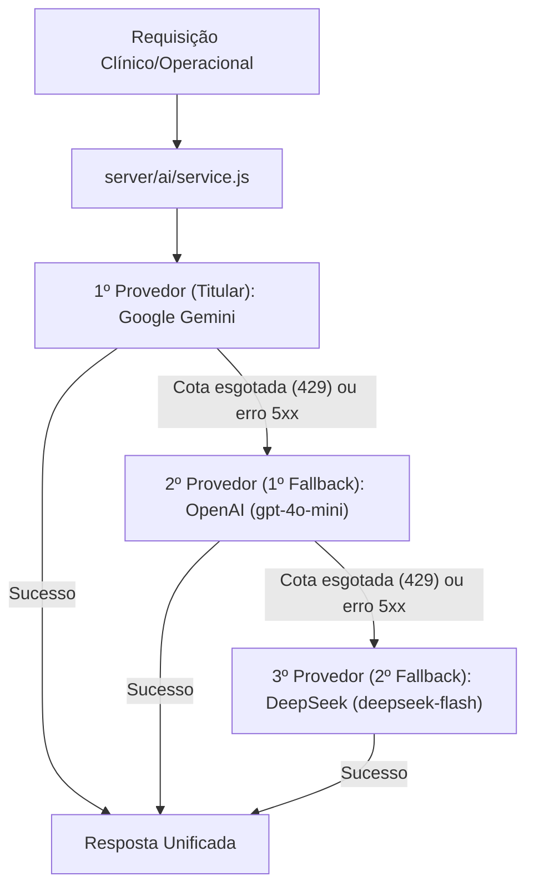

# Referência: Integração de IA e Cadeia de Fallback

Este documento descreve a arquitetura do subsistema de Inteligência Artificial da plataforma **NutrIsa**, detalhando os provedores integrados, a ordem de fallback automático, variáveis de ambiente e adaptação de contratos multimodais.

---

## 1. Visão Geral da Arquitetura

O frontend do NutrIsa comunica-se exclusivamente com a rota de backend `/api/ai` através do cliente unificado [`app/src/shared/services/aiClient.js`](../../app/src/shared/services/aiClient.js). O servidor orquestra as chamadas aos modelos de linguagem através do serviço [`server/ai/service.js`](../../server/ai/service.js).

Para garantir que a nutricionista nunca fique sem resposta em consultas clínicas (por esgotamento momentâneo de cotas gratuitas, instabilidade ou erros de rede), o NutrIsa implementa uma **cadeia de fallback inteligente de três níveis**:



O painel de configurações de IA (`AiSettings.jsx`) inclui um botão **"Testar conexão"** que dispara um ping ao vivo em paralelo (`server/ai/ping.js`) para todos os provedores configurados, exibindo em tempo real se cada IA está online e sua latência de resposta em milissegundos.

---

## 2. Ordem de Prioridade e Provedores

| Ordem | Provedor | Modelo Padrão | Capacidade Multimodal (Visão) | Variável de Ambiente | Papel no NutrIsa |
| :---: | :--- | :--- | :---: | :--- | :--- |
| **1º** | **Google Gemini** | `gemini-3.8-flash` (ou configurado em `GEMINI_MODELS`) | ✅ Sim (imagens e PDFs) | `GEMINI_API_KEY` | **Titular:** Rápido, econômico e com ampla janela de contexto. |
| **2º** | **OpenAI** | `gpt-4o-mini` | ✅ Sim (imagens base64) | `OPENAI_API_KEY` | **1º Fallback:** Altíssima estabilidade, baixa latência e compatibilidade multimodal para laudos e texto. |
| **3º** | **DeepSeek** | `deepseek-flash` | ✅ Sim (imagens base64 via API padrão) | `DEEPSEEK_API_KEY` | **2º Fallback:** Custo ultrabaixo, suporte a modo JSON e alta fidelidade em tarefas clínicas e contratuais. |

---

## 3. Estrutura de Arquivos

```
server/ai/
├── service.js                  # Orquestrador da cadeia e fallback resiliente
├── ping.js                     # Diagnóstico e ping ultraleve ao vivo das 3 IAs em paralelo
├── models.js                   # Catálogo de modelos permitidos e mapeamento de provedores
├── validation.js               # Validação segura da estrutura de entrada
├── productResearch.js          # Leitura de rótulos de produtos com Gemini interactions
└── providers/
    ├── gemini.js               # Transporte HTTP para Google Generative Language
    ├── openai.js               # Transporte HTTP para OpenAI Chat Completions (gpt-4o-mini)
    ├── deepseek.js             # Transporte HTTP para DeepSeek Chat Completions (deepseek-flash)
    └── openAiCompatible.js     # Adaptador universal de payload (Gemini ⇄ Chat Completions)
```

---

## 4. Normalização e Compatibilidade de Contratos

Todo o código consumidor no frontend (`useAvaliacao.js`, `PatientAiSummary.jsx`, `useAtendimento.js`, `useAnamnese.js`, `usePostStudio.js`, `useContratos.js`) recebe o mesmo formato unificado:

```javascript
{
  result: {
    candidates: [
      {
        content: {
          role: 'model',
          parts: [{ text: '...' }]
        },
        finishReason: 'STOP'
      }
    ]
  },
  usedModel: 'gemini-3.8-flash' // ou 'gpt-4o-mini' / 'deepseek-flash'
}
```

O adaptador [`server/ai/providers/openAiCompatible.js`](../../server/ai/providers/openAiCompatible.js) cuida de:
1. Traduzir `systemInstruction` e `contents` para o array `messages` compatível com OpenAI.
2. Converter partes de imagem (`inline_data` / `inlineData`) em URLs data-uri de `image_url`.
3. Adicionar garantia explícita de instrução JSON caso `generationConfig.responseMimeType === 'application/json'`.
4. Converter as escolhas do chat de volta para a estrutura canônica `candidates[0].content.parts[0].text`.

---

## 5. Códigos de Erro e Política de Tentativas

- **Erros que disparam fallback:** `404`, `429` (Rate limit / cota), `500`, `502`, `503` (serviço indisponível) e `504` (gateway timeout).
- **Erros que interrompem imediatamente:** `400` (payload malformado) e `403` (credencial explicitamente inválida/bloqueada), evitando requisições desnecessárias.

---

## 6. Variáveis de Ambiente no `.env`

```ini
# Titular
GEMINI_API_KEY=sua_chave_gemini
GEMINI_MODELS=gemini-3.8-flash,gemini-3.6-flash,gemini-3.5-flash-lite

# Fallbacks
OPENAI_API_KEY=sua_chave_openai
DEEPSEEK_API_KEY=sua_chave_deepseek

# Acesso de Segurança
AI_ACCESS_TOKEN=codigo_de_acesso_da_clinica
```
